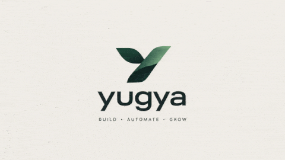

# Yugya Brand Redesign — Verification Report

**Branch:** `redesign/brand-identity` (created from `main` at `f195791`)
**Status:** Complete and verified locally. **Not merged, not deployed.** Awaiting owner visual approval.
**Date:** 3 November 2026

---

## 1. Summary

The site was rebuilt around the owner-supplied Yugya brand assets: the sage/forest/cream palette, the static logo lockups, and the animated wordmark GIF. The previous dark-navy/purple-gradient SaaS language was removed. The new direction is an editorial creative-technology studio: asymmetric layouts, serif display type, generous whitespace, real project imagery, and brand-derived rules and shapes.

All five pages share one visual system: `index.html`, `services.html`, `work.html`, `about.html`, and `contact.html`, with `style.css` and `script.js`.

---

## 2. Extracted Palette

Taken from the owner-supplied Coolors export and applied as CSS custom properties in `style.css`.

| Token | Hex | Use |
| --- | --- | --- |
| `--color-sage` | `#859E8B` | Rules, quiet accents, decorative emphasis |
| `--color-accent` | `#5D866A` | Mid green; focus rings and interactive accents |
| `--color-secondary` | `#365549` | Forest; links, labels, secondary type |
| `--color-primary` | `#1F4639` | Deep forest; dark sections and primary surfaces |
| `--color-background` | `#F7F4EF` | Cream page background |
| `--color-surface` | `#FBF9F5` | Raised panels |
| `--color-text` | `#16231E` | Body text |
| `--color-muted` | `#52655B` | Secondary copy |
| `--color-border` | `#D7DED7` | Hairlines and dividers |

Derived neutrals: `--color-surface-soft #E9EEE8`, `--color-border-strong #AEBDB2`, `--color-placeholder #5F7167`, `--color-inverse-text #F7F4EF`, `--color-inverse-muted #C9D6CD`, `--color-inverse-border #4C6B5E`.

Contrast decisions:

- Sage is **not** used for small text on cream or deep forest; it fails AA at small sizes (2.64:1 and 3.64:1).
- Small numerals and labels on dark sections use `--color-inverse-muted` (7.01:1).
- The service rail numerals use `--color-secondary` (7.5:1 on cream).
- Input placeholders use `#5F7167` (4.73:1).

No purple, cyan, neon, or unrelated accent colours remain.

---

## 3. Typography

- **Newsreader** — display serif for headlines, pull quotes, and editorial emphasis.
- **Figtree** — interface and body sans.
- **JetBrains Mono** — eyebrow labels, indices, specifications, and terminal excerpts.

Loading is via a single Google Fonts request with `preconnect` and `display=swap`.

---

## 4. Brand Asset Usage

All assets live in `assets/brand/`.

| Asset | Format / size | Usage |
| --- | --- | --- |
| `yugya-nav.webp` (19.7 KB) / `yugya-nav.png` (337 KB) | 670 × 472 | Navigation lockup, 82 × 58 display, WebP with PNG fallback |
| `yugya-logo.webp` (25 KB) / `yugya-logo.png` (378 KB) | 670 × 535 | Footer, About plate, Home studio plate, WebP with PNG fallback |
| `yugya-logo-anim.webp` (186 KB) | 480 × 270 | Homepage animated brand moment |
| `yugya-logo.gif` (710 KB) | 480 × 270 | GIF fallback for browsers without WebP |
| `yugya-poster.png` (74 KB) | 480 × 270 | Static fallback under `prefers-reduced-motion` |
| `favicon.png` / `apple-touch-icon.png` | 64 / 180 px | Favicon and Apple touch icon |
| `yugya-og.png` | 1200 × 630 | OpenGraph / Twitter card image |
| `yugya-mark.png` / `.webp` | — | Compact mark, available for future use |
| `palette.svg` | — | Palette reference |
| `yugya-logo-source.png` / `.gif` | — | Owner-supplied originals, retained unchanged |

Logo rules followed:

- Proportions preserved on every placement; no stretching, rotation, recolouring, or added effects.
- Verified display ratios match natural ratios (0.000 difference; footer within 0.0001 rounding).
- WebP substitutes have a mean pixel difference of ~1.25/255 versus the PNG originals, so the official artwork is unchanged in practice.

---

## 5. Animated Brand Moment

The GIF is used once, as the homepage hero brand panel — not as a full-page background.

Implementation in `index.html`:

```html
<picture>
  <source media="(prefers-reduced-motion: reduce)" srcset="assets/brand/yugya-poster.png">
  <source type="image/webp" srcset="assets/brand/yugya-logo-anim.webp">
  
</picture>
```

- Intrinsic `width`/`height` prevent layout shift.
- Aspect ratio is fixed at 16:9; no filters are applied.
- Normal motion resolves to `yugya-logo-anim.webp`; reduced motion resolves to `yugya-poster.png`. Both verified in Chrome.
- Optimisation: source GIF 1.79 MB → animated WebP 186 KB (≈90% smaller), with an optimised 480 × 270 GIF fallback at 710 KB.
- The GIF itself is ~727 KB; it is only requested by browsers that do not support WebP, and never under reduced motion.

---

## 6. Design Changes

### Global

- Replaced the navy/purple theme with the cream/forest/sage system.
- New header: official nav lockup, editorial nav links, compact primary CTA, full-screen mobile drawer.
- New footer: official full lockup, studio description, location, grouped links, and direct email.
- Consistent buttons, text links, form controls, tables, and focus states.
- Removed stars, particles, fake dashboards, neon glows, decorative domain/server cards, emoji icons, and repetitive rounded-card grids.

### Homepage

- Asymmetric hero with editorial headline, animated brand panel, and a four-item studio fact strip.
- Numbered capability list instead of service cards.
- Featured Aama Pathshala project with a real screenshot and a specification ledger.
- Dark forest manifesto section with a brand-derived ribbon rule.
- Four-stage process, studio/logo plate, and a high-contrast contact CTA.

### Services

- Page hero with an anchor index.
- Sticky service rail and five long-form service entries, each with scope, problem, deliverables, and after-delivery terms.
- Boundaries table distinguishing available, scoped, and out-of-scope work.

### Work

- Three clearly labelled entries: completed build, infrastructure blueprint, and personal prototype.
- Real Aama Pathshala screenshot.
- Reference Caddyfile and prototype CLI excerpts presented as static code blocks, explicitly labelled as illustrative, not live status.

### About

- Purpose section, four operating principles, location/collaboration details, and the official logo plate.
- No founder profiles, photographs, or invented biographies.

### Contact

- Page hero with direct details.
- Preparation checklist for direct email.
- Enquiry form that composes a `mailto:` draft or copies formatted text; no data is sent to a server.
- FAQ accordion using native `<details>`.

---

## 7. Responsive Verification

Tested in real Chrome (Playwright) at all required viewports:

| Viewport | Pages tested | Horizontal overflow | Console errors | Failed requests | Broken images |
| --- | --- | --- | --- | --- | --- |
| 375 × 812 | 5 | None | None | None | None |
| 390 × 844 | 5 | None | None | None | None |
| 768 × 1024 | 5 | None | None | None | None |
| 1366 × 768 | 5 | None | None | None | None |
| 1920 × 1080 | 5 | None | None | None | None |

For every page/viewport, `scrollWidth === clientWidth`. Reveal elements all became visible after scrolling. Mobile navigation opens, updates `aria-expanded`, closes on Escape, and returns focus to the toggle.

Document heights:

| Page | 375 | 390 | 768 | 1366 | 1920 |
| --- | --- | --- | --- | --- | --- |
| Home | 8,675 | 8,494 | 7,580 | 6,318 | 6,583 |
| Services | 9,075 | 8,876 | 7,127 | 6,165 | 6,309 |
| Work | 8,753 | 8,522 | 6,805 | 6,358 | 6,578 |
| About | 5,918 | 5,766 | 5,089 | 3,889 | 4,050 |
| Contact | 4,441 | 4,375 | 3,621 | 2,740 | 2,828 |

The homepage is intentionally long-form; on mobile it is a single editorial column.

---

## 8. Accessibility

- axe-core 4.10.2 run on all five pages at 375, 768, and 1366 widths (15 combinations).
- **Zero WCAG 2.0/2.1 A/AA and best-practice violations.**
- Verified: skip link, single `h1` per page, ordered headings, visible focus rings, labelled form fields, `aria-current="page"`, mobile-nav state, scrollable regions focusable (`table-wrap` and both terminals), and no nested/duplicate landmarks.
- Reduced-motion mode disables reveal transitions and serves the static brand poster.

---

## 9. Performance

Measured with Playwright resource timing in a fresh browser context per page (desktop):

| Page | Requests | Transferred | Heaviest assets |
| --- | --- | --- | --- |
| Home | 8 | ~362 KB | animated WebP 186 KB, project image 70 KB |
| Services | 10 | ~106 KB | brand WebP assets |
| Work | 11 | ~177 KB | project image 70 KB |
| About | 10 | ~106 KB | brand WebP assets |
| Contact | 10 | ~106 KB | brand WebP assets |

Switching nav/footer/plate logos to WebP with PNG fallback reduced the homepage from ~1,025 KB to ~362 KB and inner pages from ~769 KB to ~106 KB.

CSS is ~48 KB, JavaScript ~9 KB, and fonts are the only third-party request. There is no framework, no build step, and no client-side routing.

---

## 10. Functional Verification

- All internal links and anchors resolve.
- Contact form `?service=` preselect works for `web`, `vps`, `dns`, `automation`, and `maintenance`.
- Clipboard copy works and includes the recipient email and all entered fields.
- Short-description validation message appears correctly.
- Empty required fields are blocked by native validity.
- No console errors or page errors on any page.

---

## 11. Factual Guardrails

Retained or corrected:

- Location: Kapilvastu / Rupandehi, Nepal · UTC +5:45.
- Email: `hello@yugya.com`; response aim 1–2 business days.
- 30 calendar days of post-launch bug-fix support.
- No founder names, photos, or biographies.
- No invented project counts, client counts, testimonials, ratings, awards, or traffic metrics.
- No uptime guarantee; the server entry explicitly says it is a reference baseline, not a managed hosting product.
- Removed the old "uptime monitoring" service claim and the old "148 structured notes" metric.
- The prototype entry is labelled a personal experiment, not a commercial product.
- `foundingDate: 2024` was already present on `main` and was retained, not invented.

The only occurrence of "Aayush" is the project name **AayushAI Core** on the Work page, not a personal profile.

---

## 12. Screenshots

Captured at full page height in `verification_screenshots/redesign/` (gitignored by design):

- `index-375x812.png`, `index-390x844.png`, `index-768x1024.png`, `index-1366x768.png`, `index-1920x1080.png`
- `services-…` for the same five viewports
- `work-…` for the same five viewports
- `about-…` for the same five viewports
- `contact-…` for the same five viewports
- `nav-open-375x812.png` — mobile navigation open
- `index-reduced-motion-1366x768.png` — static poster fallback
- `report.json` — layout, image, console, and request data
- `axe.json` — accessibility results

---

## 13. Remaining Issues / Notes

1. **Owner approval is pending.** Nothing has been merged or deployed.
2. The homepage is long (≈8,675 px at 375 width). This is deliberate editorial pacing, but it can be shortened if the owner prefers a tighter mobile page.
3. Legacy root images (`yugya.png`, `Aayush-Bhandari.jpg`, `aayush-bk.jpg`, `sagar-bhusal.jpg`) remain in the repository but are no longer referenced. They were left in place rather than deleted in case the owner wants them archived.
4. The form has no backend; it composes an email draft or copies text by design. A server-side endpoint would require separate infrastructure and privacy copy.
5. Animated WebP is supported by current Chrome, Edge, Firefox, and Safari; the GIF fallback covers older browsers. The fallback is intentionally larger but only downloaded when needed.
6. The nested `yugya/` directory is an untracked asset/draft source and is intentionally excluded from this commit.

---

## 14. Approval Checklist

- [x] Palette matches the owner-supplied export exactly.
- [x] Official logo used without distortion or recolouring.
- [x] GIF placed as a single homepage brand moment with static reduced-motion fallback.
- [x] Old visual language removed.
- [x] All five pages consistent.
- [x] Responsive at 375, 390, 768, 1366, and 1920.
- [x] No horizontal overflow, console errors, failed requests, or broken images.
- [x] axe: zero violations.
- [x] Factual claims audited.
- [ ] Owner visual approval.
- [ ] Merge and deploy (intentionally not done).
